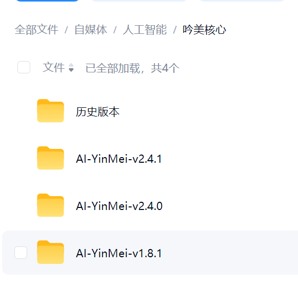
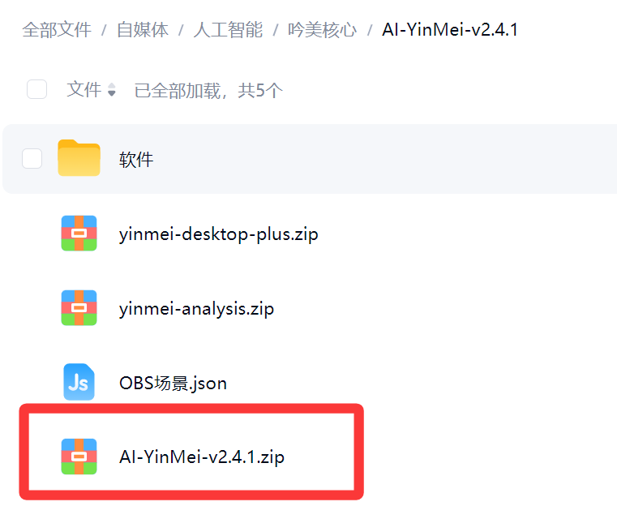
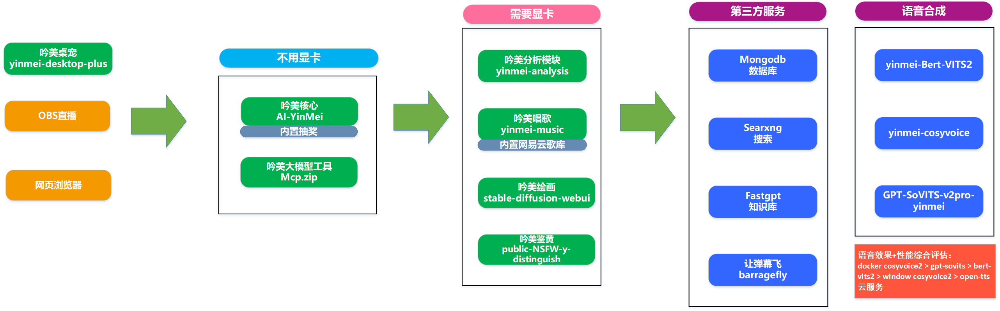
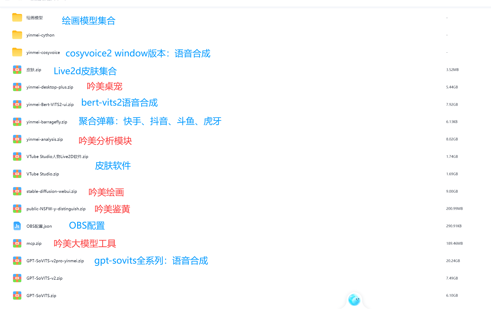
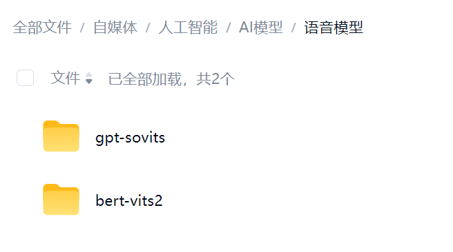
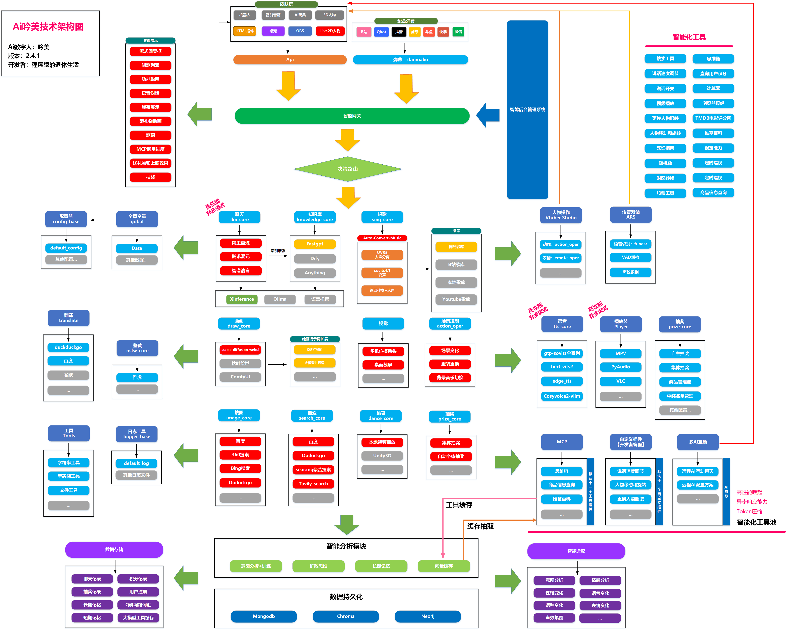
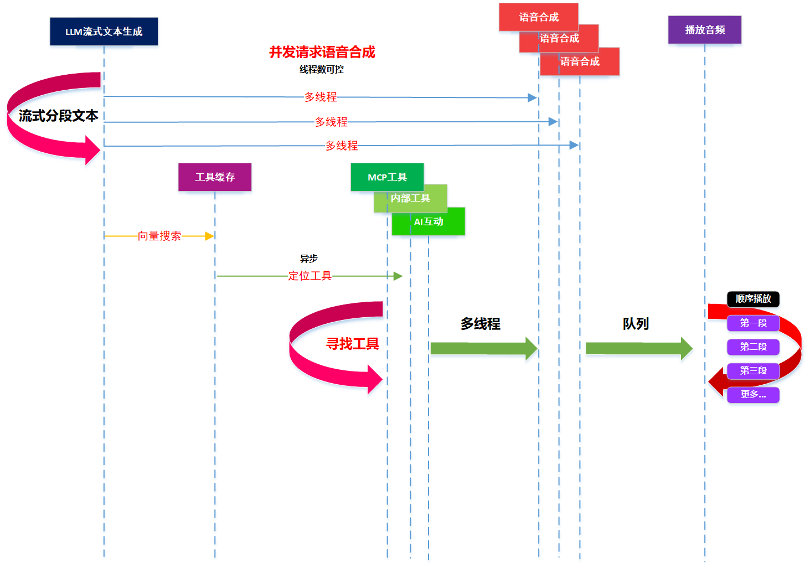
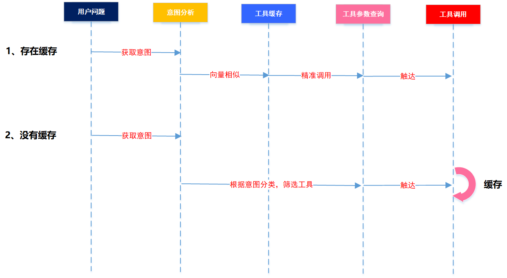
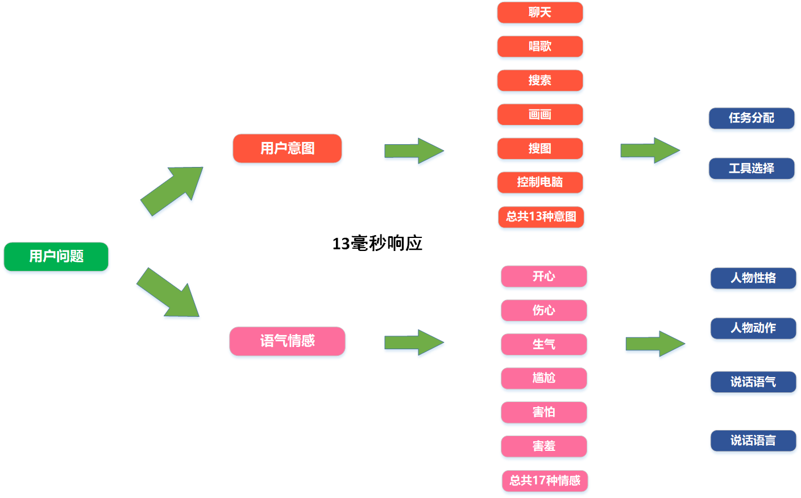
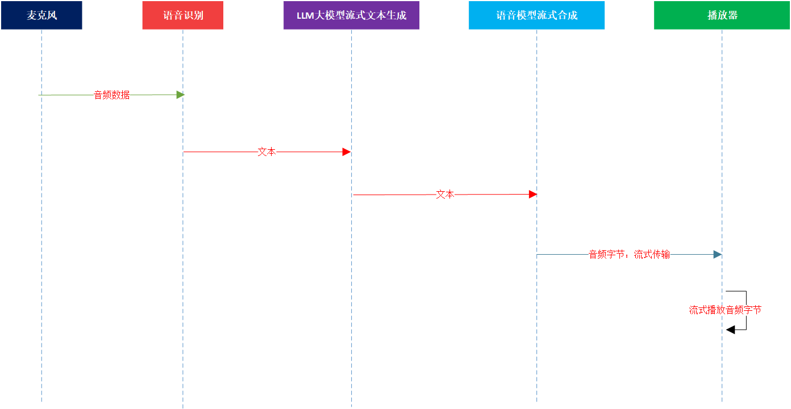

## AI吟美の資料
- **AI名：** 吟美
- **開発者：** Winlone
- **B站チャンネル：** 程序猿的退休生活 [クリックして移動](https://space.bilibili.com/46130941)
- **配信ルーム：** [クリックして移動](http://live.bilibili.com/3033646)
- **技術QQグループ：** 27831318
- **ファン特典グループ：** 264534845
- **バージョン：** 3.0.0-Pre
- **動画デモ：** [視聴する](https://www.bilibili.com/video/BV17mfZBkEMR)
- **オープンソース：** [プロジェクトへ](https://github.com/worm128/AI-YinMei)

## ソフトウェアのダウンロード
[Docker版](https://hub.docker.com/r/worm128/yinmei-core) | [Windows版](https://pan.baidu.com/s/11kIws0H0YITmwVucqoCWrA?pwd=6e74) | [Linux版](https://pan.baidu.com/s/11kIws0H0YITmwVucqoCWrA?pwd=6e74)

## プロジェクトのダウンロード
- **吟美統合パッケージのダウンロード先：**  
百度網盤グループ：「百度網盤->メッセージ」からグループ番号を追加してください   
百度網盤グループ番号1：930109408（満員）  
百度網盤グループ番号2：939447713（満員）   
百度網盤グループ番号3：945900295（満員）   
百度網盤グループ番号4：969208563  
百度網盤グループ番号5：975062976  
百度網盤グループ番号6：975962307  
- **夸克：**   
夸克グループ1：1231405830   
夸克グループ2：428937868   
- **吟美コア【バージョン更新】：**  
ダウンロードパス：人工知能 -> 吟美コア  
圧縮ファイル：AI-YinMei-v3.0.0.zip  
- **機能統合パッケージのダウンロード：**  
ダウンロードパス：人工知能 -> yinmei-all  
圧縮ファイル：吟美デスクトップペット2.0-yinmei-desktop-plus.zip、cosyvoice2音声合成：yinmei-cosyvoice、GPT-SoVITS音声合成：GPT-SoVITS-v2pro-yinmei.zip、bert-vits2音声合成：yinmei-Bert-VITS2-ui.zip、大規模モデルツール：mcp.zip、NSFW判定：public-NSFW-y-distinguish.zip、お絵描き：stable-diffusion-webui.zip、キャラクター：VTube StudioキャラクターLive2Dソフト.zip  

## 統合パッケージの内容
> 必須ダウンロード：AI-YinMei-v3.0.0.zip、yinmei-analysis.zip、yinmei-desktop-plus.zip、mcp.zip  

吟美コア、パス：人工知能->吟美コア。バージョンを1つ選んでダウンロードしてください。通常は最新バージョンです  
  
ディレクトリに入り、AI-YinMei-v3.0.0.zipをダウンロードします  
  
各吟美モジュールの分割詳細    
  

その他の機能モジュール、パス：人工知能->yinmei-all  

音声モデルのダウンロード、パス：人工知能->AIモデル->音声合成モデル  

## モジュールのリソース配分
> 以下のリソース説明はすべて概算であり、最高の効果を得る場合のリソース使用状況を説明しています  
### 音声合成：
gpt-sovits：メモリ-2~4G、VRAM-2.6G  
cosyvoice2（Docker版）：メモリ-20G、VRAM-4.6G  
bert-vits2：メモリ-7.3G、VRAM-2.3G  
### 吟美モジュール：
吟美コア：メモリ-200MB、VRAM-0G  
吟美分析：メモリ-1.5G、VRAM-1.9G  
吟美デスクトップペット：メモリ-2~5G、VRAM-1.5G  
MCPツール：メモリ-1G、VRAM-0G  
### その他サードパーティ：
Vtube Studioキャラクター：メモリ-1G、VRAM-1G  
WSL Docker：メモリ-2G以上、VRAM-0G  
Xinference：メモリ-不明、VRAM-0G  
m3eベクトルモジュール：メモリ-無視できる程度、VRAM-600MB  
fastgptナレッジベース：メモリ-400MB、VRAM-0G  
让弹幕飞：メモリ-800MB、VRAM-0G  
OBS：メモリ-1.3G、VRAM-600MB  
その他のライブ配信ソフト：メモリ-1~2G以上、VRAM-推定600MB  
### 完全なライブ配信のリソース使用量：
#### 基本ライブ配信：
吟美コア＋吟美分析＋音声合成＋WSL Docker＋Vtube Studioキャラクター＋OBS = メモリ-8G、VRAM-7.6G  
推奨デスクトップPC：メモリ-16G、VRAM-8~10G  
#### 対話ライブ配信：
吟美コア＋吟美分析＋吟美デスクトップペット＋音声合成＋WSL Docker＋Vtube Studioキャラクター＋OBS = メモリ-10~13G、VRAM-9G  
推奨デスクトップPC：メモリ-32G、VRAM-16G  

## 機能概要
- **コメント集約：** ライブ配信のコメントを集約。B站オープンプラットフォーム、napcat[QQボット]、barragefly[抖音、虎牙、快手、斗魚]、WeChatライブ配信、デスクトップペット、バックエンドチャット対話など9大ソースチャンネルのコメントを集約表示します。
- **意図分析：** 10ミリ秒で応答する意図分析。自主的にコーパスを学習させて意図分類を増やせます。現在はマルチヘッドアテンション機構を採用しており、意図分類＋感情分類を同時に分析できます。
- **大規模モデルツール：** MCPツールに対応し、自作コードツールも作成可能。ツールには、カメラ観察、定期巡回、視覚能力、画像検索、挨拶操作、Wikipedia、TMDB映画評価サイト、ブラウザ操作、電卓、ユーザーポイント照会、高度検索、思考チェーン、商品情報照会、株価ツール、タイムゾーン変換、乱数、料理ガイド、キャラクター衣装変更、キャラクター移動と回転、動画検索と再生、発話音声合成のオン/オフ、話速調整、AI動画、AI歌唱、AIお絵描き、検索ツールなど27個のツールがあります。
- **抽選：** 抽選は自主抽選と配信者抽選に分かれます。自主抽選はユーザーが「抽選」コメントを入力してリアルタイム抽選を行うもの、配信者抽選は配信者が場をコントロールしながら抽選ボタンをクリックし、配信ルーム内のオンラインユーザー全員を対象に抽選するものです。抽選景品リスト、抽選記録などの機能があります。
- **長期記憶：** 時間を表す語に応じて、異なる時間範囲の記憶をインテリジェントに呼び起こします。毎回記憶を呼び起こしてメインフローの速度に影響を与えることはなく、選択的に記憶を呼び起こします。件数や類似度などを設定できます。
- **短期記憶：** mongodbデータベースに記録される大規模モデルのコンテキスト記憶で、すべてのチャット記録は全量永続化されます。
- **ポイント：** 各ユーザーのチャット、いいね、ギフト、登録でポイントが増加します。歌唱、お絵描き、動画再生、曲送り、抽選でポイントが差し引かれます。ポイント設定プランがあります。
- **拡散思考：** グラフ関係データベースneo4jを使用して語句の関係を構築します。QQグループのデータをエクスポートして思考関係のトレーニングができ、分析されたグラフはneo4jで表示されます。
- **チャット：** すべてのOpenAI仕様のクラウドサービスプロバイダーとローカルサービスに対応。LLM大規模モデルのサポート率は100%を達成しています。LLMはストリーミング対応済みで、高性能な対話が可能です。
- **音声：** cosyvoice2、bert-vits2、gpt-sovits全シリーズ、edge-ttsに対応。うちOpenAI仕様のTTSは市販TTSクラウドプロバイダーの80%をサポートします。cosyvoice2は私が語気と感情を微調整・魔改造し、vllmで高速化したもので、市販の音声合成より強力で高速です。音声はストリーミング対応済みで、高性能なTTSです。
- **視覚：** OpenAI仕様のデータモデルに対応し、ほとんどのクラウドプロバイダーの視覚モデルをサポートします。
- **カメラ：** 複数のカメラによる監視・分析に対応します。
- **PC制御：** 画面分析に基づいてキーボードとマウスを自律制御できます。
- **ライブ配信UIプラグイン：** 配信を補助する18個のUIプラグインに対応します。
- **ナレッジベース：** 現在はfastgptナレッジベースの機能を使用して知識の管理と読み込みを行っています。
- **歌唱：** あらゆる言語の歌をカバーできます。1曲の学習時間は約150秒~200秒です。歌唱モデルは音色を自主トレーニングできます。
- **お絵描き：** civitai.comから任意の絵画モデルをダウンロードして描画できます。
- **画像検索：** 百度検索を使用して画像検索を行います。
- **検索：** 検索集約プラットフォームsearxngを使用して検索します。Google、bing、duckduckgo、wikipedia、startpage、braveなどの検索エンジンが含まれており、VPN（魔法のインターネット）が必要です。
- **キャラクター：** 自作の吟美デスクトップペットとVtube Studioに対応します【Steamまたは本製品の網盤からダウンロード可能】。吟美デスクトップペットはマイク機能を内蔵し、強力なノイズ除去能力、VAD能力、AEC能力を備え、声紋システムを重ねることでリアルタイム対話でも誤操作しません。
- **表情：** 表情プランでキャラクターの表情を制御できます。キャラクター表情＋効果音＋動画の再生に対応し、ループ回数やランダム再生、キーワードによる表情トリガーに対応します。
- **動画：** ローカルのフォルダ内にある任意の動画を再生できます。サブフォルダに動画を保存することも可能です。B站動画の取得・再生に対応します。
- **NSFW：** 画像のNSFW判定に対応し、コメント内の違法文字、AI返信の違法文字、お絵描きの違法プロンプトをフィルタリングできます。
- **その他：** アイドルタイムタスク、入室時の歓迎メッセージ、Dockerサービスの自動インストール、サーバー監視、データ統計に対応します。

## コマンド説明
**1. 基本コマンド：**  
1.1 「\」を付ける 例：「\ライブ配信ルームでチャットします」とすると、AIはユーザーの内容に返信しません

**2. 歌唱機能：**  
2.1 「歌唱＋曲名」を入力すると、吟美は入力された曲名に基づいて歌を学習して歌います。もちろん、「吟美、一番聴き心地のいいアニソンを教えて」のようなオープンな話題を入力して、吟美にインテリジェントに曲を選ばせて歌わせることもできます。
2.2 曲送りは「曲送り」コマンドを入力すると、現在の曲をスキップして次の曲を直接歌います
2.3 「歌の学習を停止」を入力すると、吟美は現在の学習プロセスを終了し、次の曲の学習に移ります

**3. お絵描き機能：**  
3.1 「お絵描き＋絵のタイトル」を入力すると、吟美は入力された絵画プロンプトに基づいてリアルタイムで描画します。
3.2 もちろん、「吟美、一番ブサイクな小亀の卵を描いて」のようなオープンな話題を入力して、吟美にインテリジェントに絵画プロンプトを出力させて描かせることもできます。

**4. 動画再生機能：**  
4.1 「動画＋ダンス名」を入力します。ダンスは以下の通りです：
動画ファイルはローカルに設定する必要があります
书记舞、科目三、女团舞、社会摇
呱呱舞、马保国、二次元、涩涩
蔡徐坤、江南 style、Chipi、吟美
「動画」の2文字だけを入力するとランダムに踊ります
4.2 ダンスを停止するには「動画停止」を入力してください

**5. 表情機能：**  
「表情＋名前」、「表情＋ランダム」はランダム表情です。表情は自分で推測してください。例えば「泣く、笑う、舌を出す」などです

**6. シーン切り替え機能：**  
6.1 「切り替え＋シーン名」を入力： ピンクの部屋、神社、海岸花坊、花房、朝の部屋
6.2 システムが時間をインテリジェントに判定して昼夜のシーンを切り替えます

**7. 着せ替え機能：**  
「着せ替え＋服の名前」を入力：普段着、愛の翼、青春猫娘、メガネ猫娘

**8. 画像検索機能：**  
「画像検索＋キーワード」を入力

**9. 情報検索機能：**  
「検索＋キーワード」を入力

## 技術アーキテクチャ

