## 一、起動方法
### 1、パッケージのダウンロード 
ダウンロードパス：[網盤](/jp/link)のyinmei-allフォルダ  
アプリケーションパッケージ：yinmei-analysis.zip  

### 2、cudaのインストール
**現在のバージョン：**
```cmd
NVIDIA：cuda 12.4
現在のプロジェクト：pytorch 2.4.0+cu124
```
**互換性について：**現在のインストール版はcuda12.4のみ対応しています。50系GPUでより新しいバージョンのcudaが必要な場合は、ご自身でpytorchをアンインストールしてインストールしてください  
cuda開発キットのダウンロード【バージョン12.4】：https://developer.nvidia.com/cuda-12-4-1-download-archive  
cudaの過去バージョン：https://developer.nvidia.com/cuda-toolkit-archive  
**pytorchの再インストール：**  
インストールするpytorchをcu128、cu124、cu126からご自身で選択してください。詳細は[こちら](https://pytorch.org/get-started/locally/)を参照  
プロジェクトのルートディレクトリでcmdを開き、以下のコマンドを実行します：  
```cmd
アンインストール
.\runtime\python.exe -m pip uninstall torch torchvision torchaudio

対応するcuda12.8をインストール
.\runtime\python.exe -m pip install torch torchvision torchaudio --index-url https://download.pytorch.org/whl/cu128
```

ドライババージョン【nvidiaドライバー】：nvidia-smi -l 1  
CUDAプログラム【cudatoolkit開発キット】：nvcc -V  

### 3、起動方法 
「yinmei-analysis-api.exe」または「start.bat」をダブルクリックして起動します  


## 二、拡散思考
### 1、neo4jグラフデータベースのインストール
Windowsシステムにインストールされたdockerシステムをベースにインストールします  
```json
docker run -d --name=yinmei-neo4j --publish=7474:7474 --publish=7687:7687 `
-v /j/ai/ai-code/yinmei-neo4j/data:/data -v /j/ai/ai-code/yinmei-neo4j/logs:/logs `
-v /j/ai/ai-code/yinmei-neo4j/import:/var/lib/neo4j/import -v /j/ai/ai-code/yinmei-neo4j/plugins:/plugins `
-v /j/ai/ai-code/yinmei-neo4j/metrics:/metrics -v /j/ai/ai-code/yinmei-neo4j/conf:/var/lib/neo4j/conf `
neo4j
```
ポート7687：外部からデータベースに接続するためのポート  
ポート7474：Webベースのグラフィカルユーザーインターフェース（Browser Interface）、すなわちNeo4j Browserを提供するためのポート  
/data：データベースディレクトリ。パスはご自身の物理パスに変更してください：「/j/ai/ai-code/yinmei-neo4j/data」  
/import：データのインポート・エクスポートディレクトリ。パスはご自身の物理パスに変更してください：「/j/ai/ai-code/yinmei-neo4j/import」  
/plugins：プラグインディレクトリ。パスはご自身の物理パスに変更してください：「/j/ai/ai-code/yinmei-neo4j/plugins」  
/conf：プロジェクト設定。パスはご自身の物理パスに変更してください：「/j/ai/ai-code/yinmei-neo4j/conf」  
コンテナ起動後  
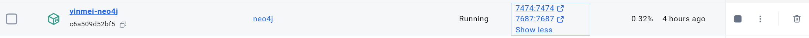  
バックエンドログイン：  
アドレス：http://localhost:7474/browser/  
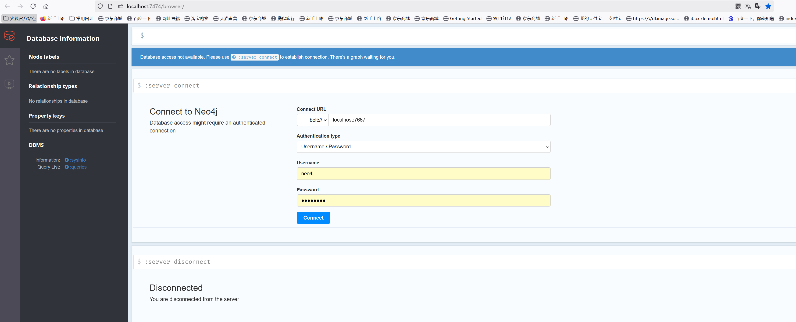  
データベース名はデフォルトでneo4jです。もちろんカスタマイズも可能ですが、ここでは勝手な操作はおすすめしません  
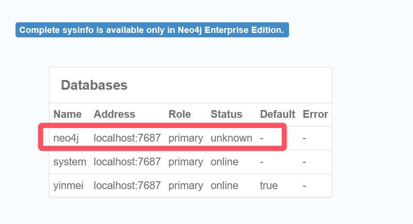  

### 2、吟美分析モジュールのneo4j接続設定
#### 2.1 アプリケーションの起動：yinmei-analysis
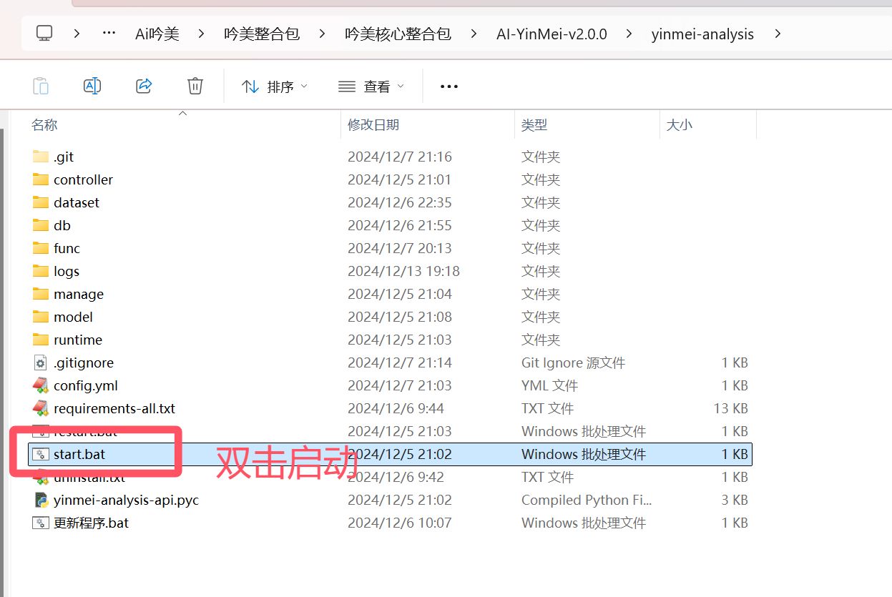  
アドレス：http://127.0.0.1:9001/  
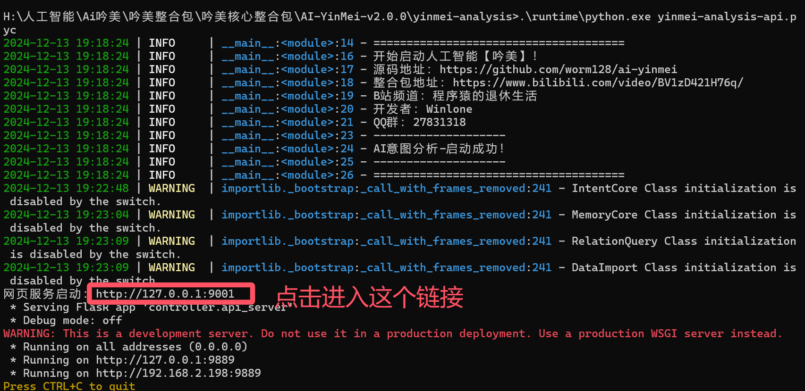  
#### 2.2 吟美バックエンド
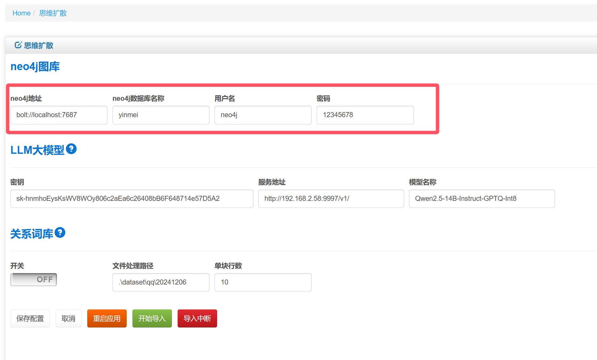  
neo4jアドレス：bolt://localhost:7687  #ここに注意：boltはバイナリプロトコルで、性能が最も良く、推奨です  
neo4jデータベース名：neo4j  
ユーザー名とパスワード：デフォルトアカウントneo4j、パスワードneo4j  

### 3、語彙のインポート
#### 3.1 コーパスの準備
旧版QQのダウンロード先：https://im.qq.com/pcqq/index.shtml  
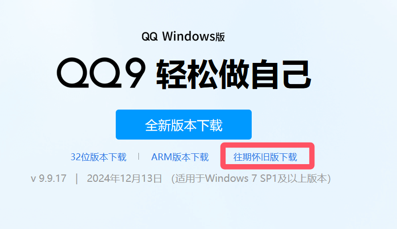  
コーパスのエクスポート  
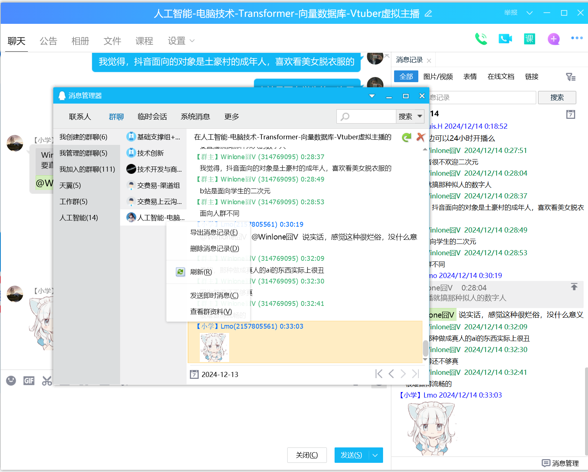  

#### 3.2 コーパスのクリーニング
QQデータセットのクリーニング：  
ソフトウェアNotepad++を使用  
  
クリーニングが必要なすべてのtxtファイルを開く  
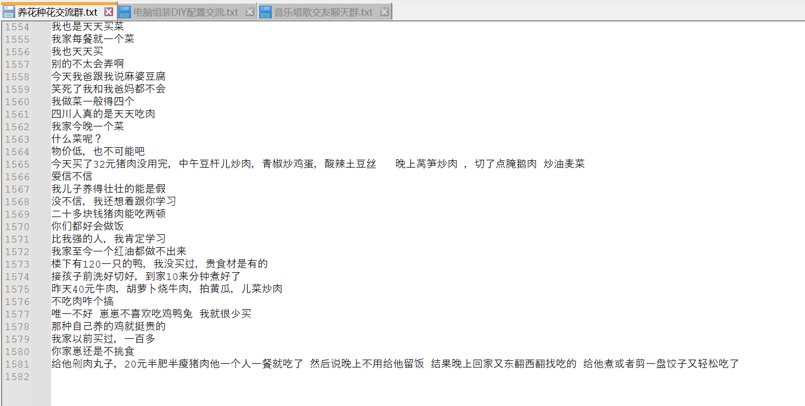  
検索と置換をクリックして置換を実行  
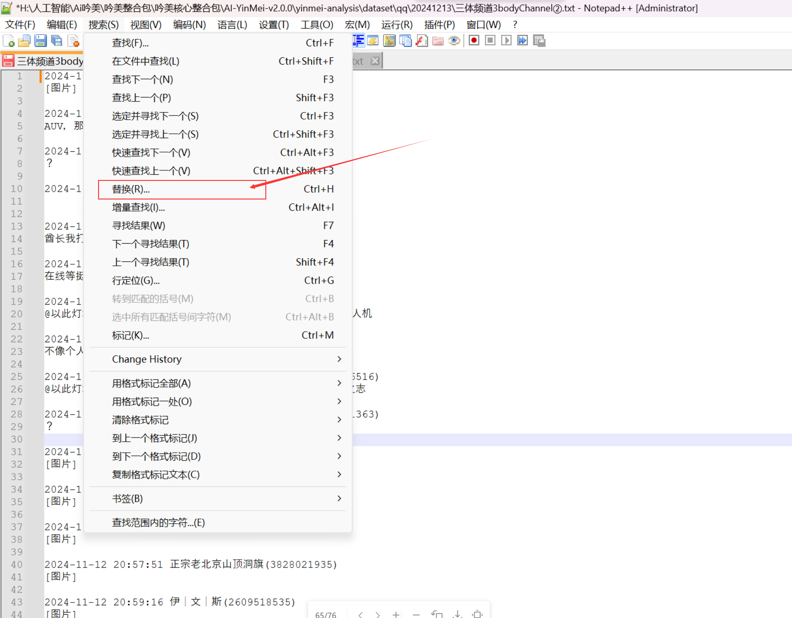  
このように対象を選択して、開いているすべてのtxtファイルを置換します  
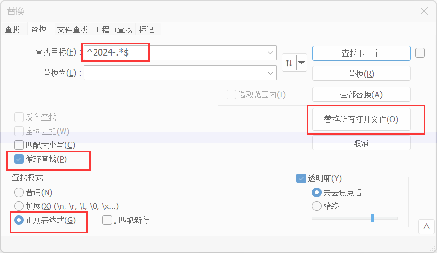  

**正規表現クリーニング：**  
```regexp
^2024-.*$
^2025-.*$
\[.+\]
\[表情\]
\[图片\]
\[\]   //無駄な[]を置換
^[?|.|。|？|,|，|…|！|!|@]+\s*$    //1行が記号のみの場合を置換
^.*暂不支持该消息类型，请用手机QQ查看.*$
^.*新版手机QQ.*$
^.*已经是群成员.*$
^.*QQ版本低需升级.*$
^.*加入本群.*$
^.*撤回了一条.*$
^.*欢迎.*加入.*本群$
^早$
@(\S)+\s    //@ユーザー名にマッチ。notepadを使用
@(\S.* )+   //ユーザー名の置換を補足。慎重に使用。後ろの中国語にマッチする可能性あり。notepadを使用
^[0-9]$   //1行の数字
.*核.*元/.年    //アリババクラウドの広告
^\n\r   //改行を空に置換
^\n   //改行を空に置換   
^\r  //復帰を空に置換
http[s]?://(?:[a-zA-Z]|[0-9]|[$-_@.&+]|[!*(),]|(?:%[0-9a-fA-F][0-9a-fA-F]))+   //URLリンクを識別。notepadを使用
```

すべてのファイルを保存  
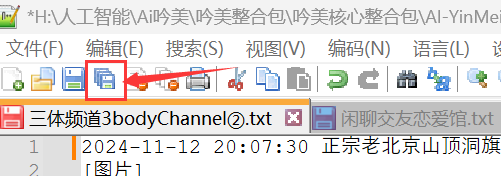  

#### 3.3 大規模モデルの設定
OpenAI仕様のAPIを使用します。ここではローカルのone apiインターフェースを使用した例を示します  
トークン：  
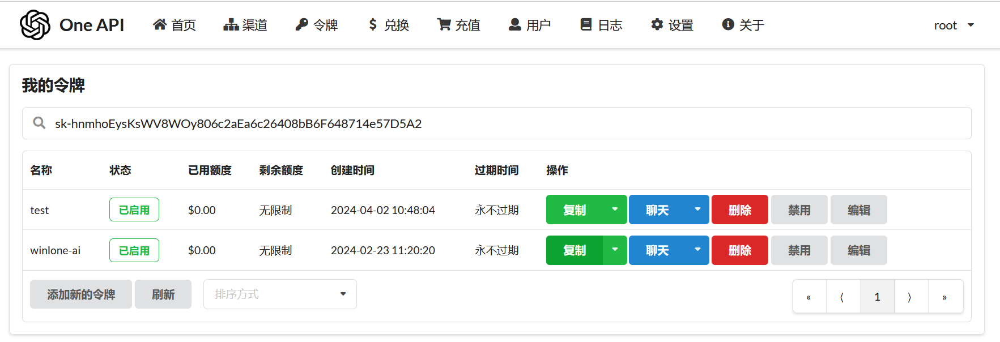  
サービスアドレス：http://192.168.2.58:9997/v1/   #これはあなたのone apiのデプロイアドレスのインターフェースです。通常はIPとポートを変更するだけで済みます。openai仕様は後ろにv1パスが付きます  
モデル名：Qwen2.5-14B-Instruct-GPTQ-Int8  

#### 3.4 上記のパラメータを大規模モデルに設定
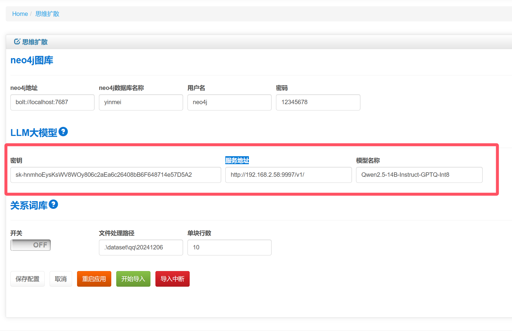  

#### 3.5 関係グラフライブラリを開く
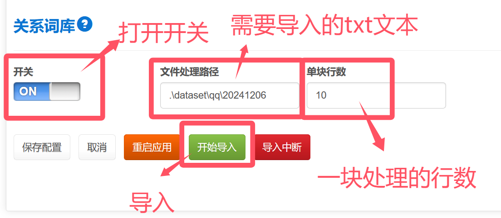  

**ファイル処理パス：**  
複数ファイルを入れることができ、全ファイルを順番に一括実行できます  
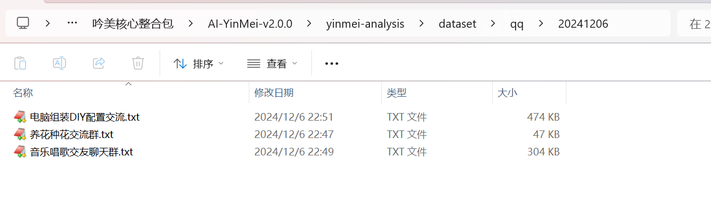  

**1ブロックあたりの行数：**  
10に設定すると、10ブロックのテキストごとにLLMで関係語彙を抽出します  
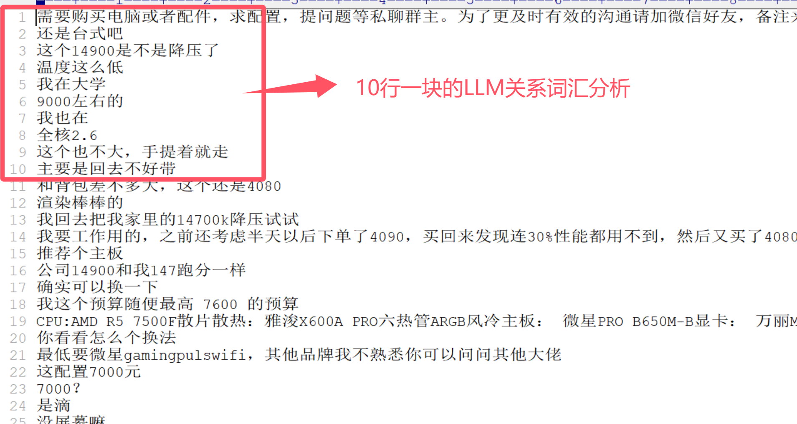  

**次にインポートボタンをクリック：**    
  
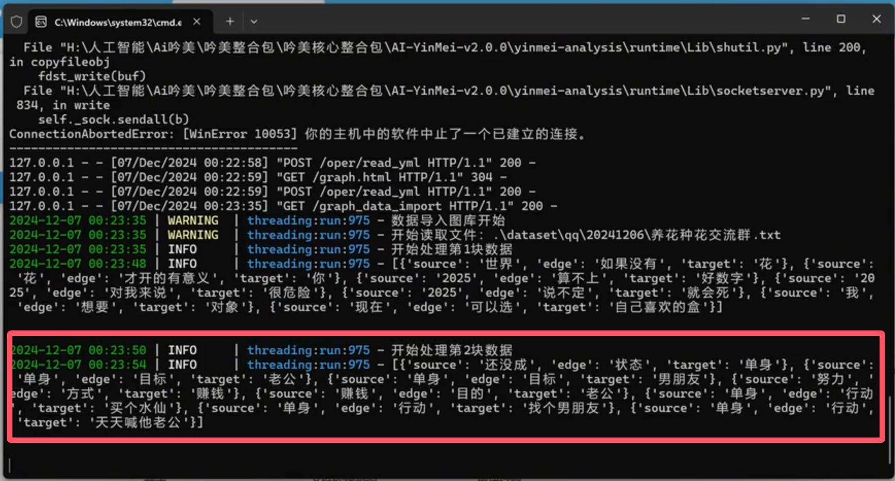  

**インポートを中断可能：**  
  
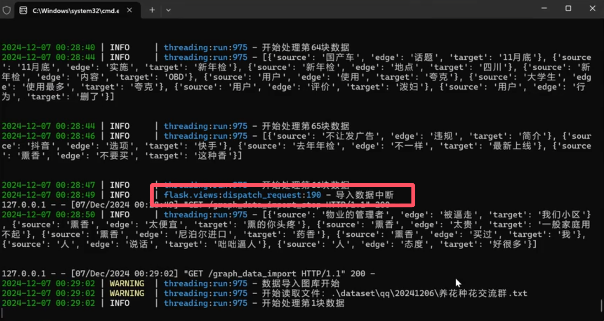  

### 4、語彙検索
吟美コアで関係語彙ライブラリを関連付け設定  
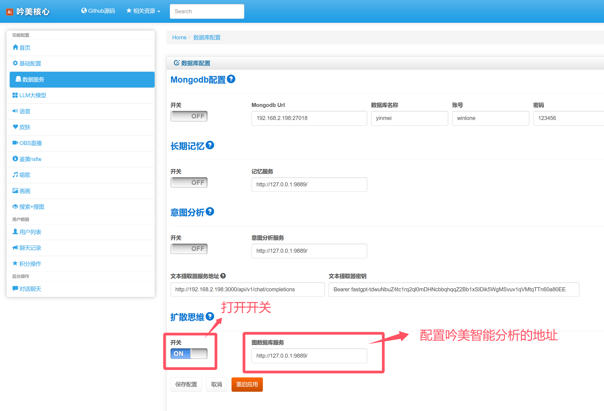  
ユーザーがチャットでどんなジョークがあるか尋ねると、吟美は語彙ライブラリから「地獄ジョーク」のコーパスを抽出します  
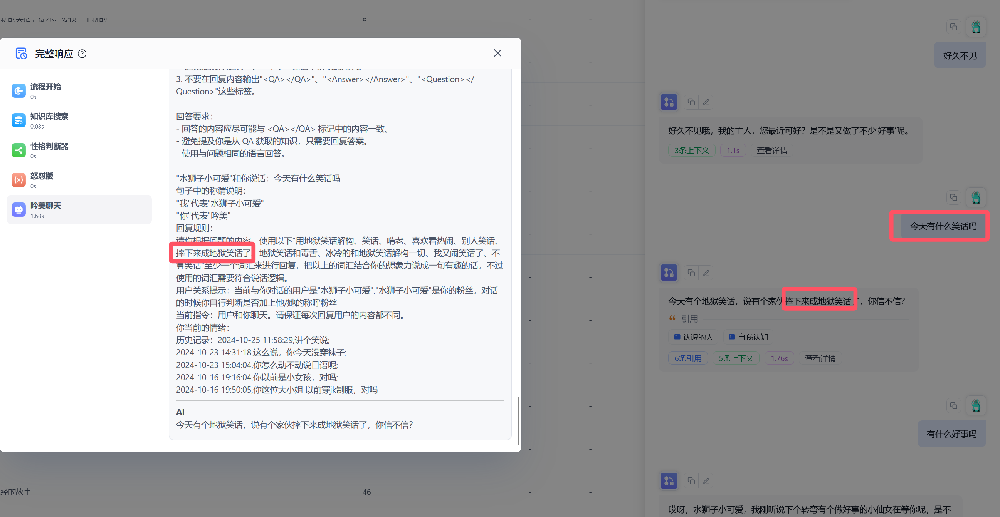  

### 5、neo4jコマンド構文
25行のデータを照会  
```sql
MATCH (n) RETURN n LIMIT 25
```

ノードのあいまい検索  
```sql
MATCH (a)-[r]->(b)
WHERE a.name =~ '.*年.*'
RETURN r,startNode(r) AS start_node, endNode(r) AS end_node
```
```sql
MATCH (a)-[r]->(b)
WHERE a.name =~ '.*来.*' or b.name =~ '.*来.*'
RETURN r,startNode(r) AS start_node, endNode(r) AS end_node
```

すべてのデータを削除  
```sql
MATCH (n)
DETACH DELETE n
```
