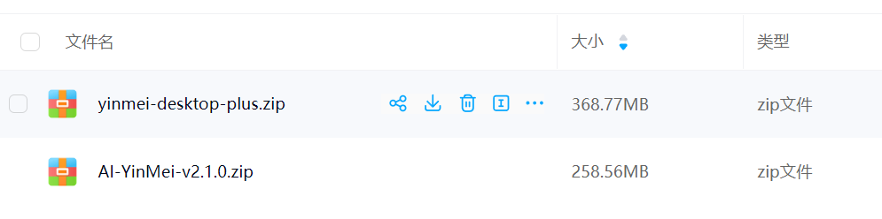
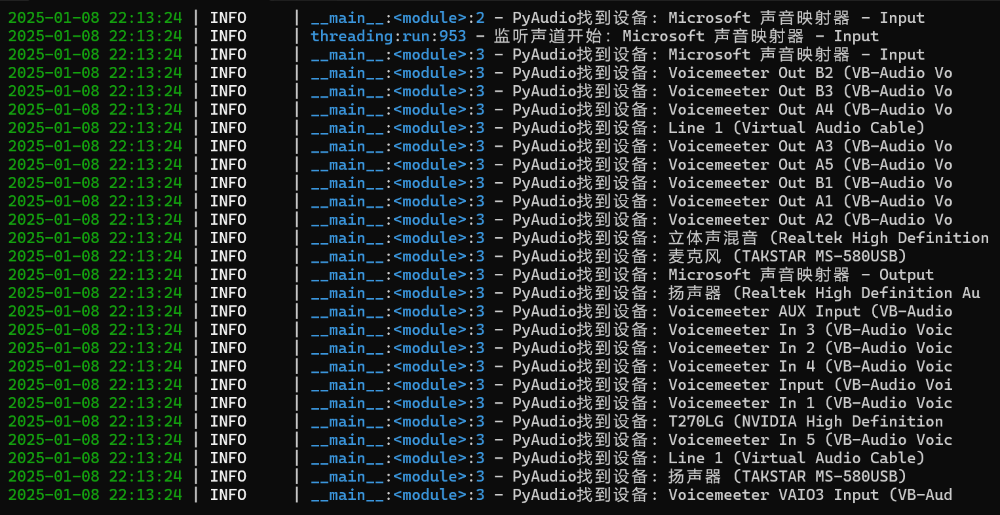
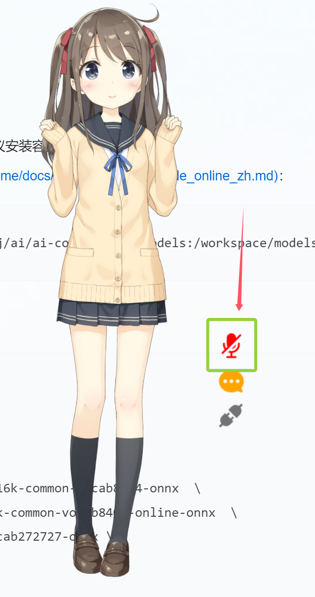
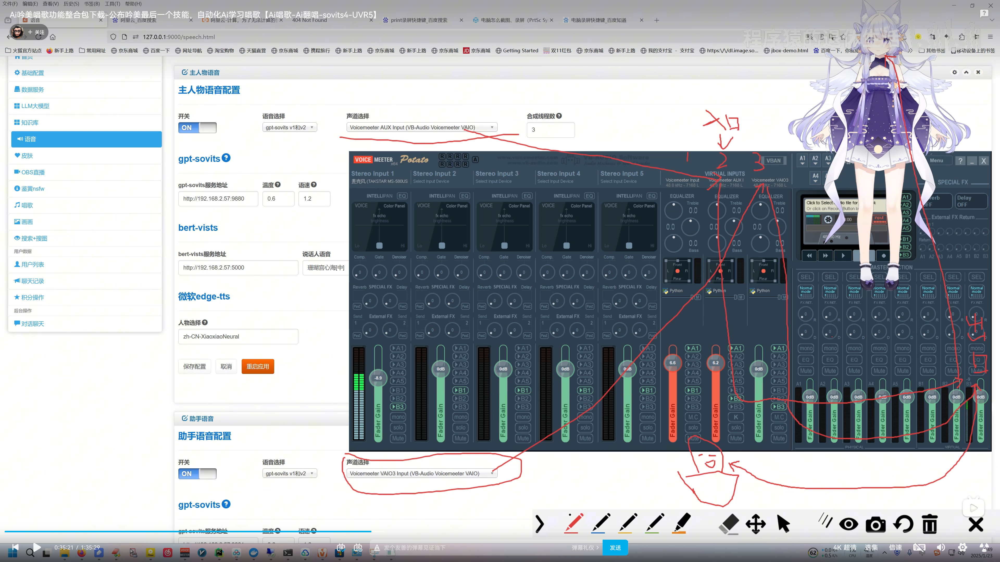

## 一、起動方法
### 1、パッケージのダウンロード
ダウンロードパス：[網盤](/jp/link)のyinmei-allフォルダ  
アプリケーションパッケージ：yinmei-desktop-plus.zip  
  

### 2、cudaのインストール
**現在のバージョン：**
```cmd
NVIDIA：cuda 12.4
現在のプロジェクト：pytorch 2.4.0+cu124
```
**互換性について：**現在のインストール版はcuda12.4のみ対応しています。50系GPUでより新しいバージョンのcudaが必要な場合は、ご自身でpytorchをアンインストールしてインストールしてください  
cuda開発キットのダウンロード【バージョン12.4】：https://developer.nvidia.com/cuda-12-4-1-download-archive  
cudaの過去バージョン：https://developer.nvidia.com/cuda-toolkit-archive  
**pytorchの再インストール：**  
インストールするpytorchをcu128、cu124、cu126からご自身で選択してください。詳細は[こちら](https://pytorch.org/get-started/locally/)を参照  
プロジェクトのルートディレクトリでcmdを開き、以下のコマンドを実行します：  
```cmd
アンインストール
.\runtime\python.exe -m pip uninstall torch torchvision torchaudio

対応するcuda12.8をインストール
.\runtime\python.exe -m pip install torch torchvision torchaudio --index-url https://download.pytorch.org/whl/cu128
```

ドライババージョン【nvidiaドライバー】：nvidia-smi -l 1  
CUDAプログラム【cudatoolkit開発キット】：nvcc -V  

### 3、起動方法
デスクトップペットの起動：起動桌宠.bat または yinmei-desktop-plus.exe  
オーディオ設定の確認：「查询音频设备.bat」をダブルクリック  


## 二、デスクトップペット設定
【config.ymlの設定】  
**口パクの一致：**live2D_audio_deviceパラメータ。デフォルトはスピーカー（Realtek High Definition）への出力です。ご自身で設定してください  
**マイク：**mic_audio_deviceパラメータ。デフォルトはVoicemeeter Out B3への出力です。ご自身で設定してください  
**オーディオ設定について：**「查询音频设备.bat」をダブルクリックすると音声チャンネルデバイスの一覧を確認できます  
  
**live2Dキャラクターの選択：**model_pathパラメータ。キャラクターモデルのパスをご自身で変更してください："./Resources/v3/Hiyori/Hiyori.model3.json"  
**キャラクターのモーション：**v2版Epsilonとv3版Hiyoriのみ設定済みです。他のキャラクターはまだモーションと表情の関連付けを設定していません。EpsilonとHiyoriを参考にnameパラメータを追加してご自身で設定できます。大文字と小文字に注意してください  

## 三、音声対話
音声ボタンをオン：音声はfunasr音声認識システムに依存します  
  

### funasrサーバーシステムをインストールしないと使用できません  
funasr音声認識には2つの方式があり、1つはdocker、もう1つは内蔵のインストール不要版です。設定は以下の通りです：  
```yaml
asr:  # 音声認識：funASR
  select: "funasr_local"  #funasr_local：ローカルインストール不要、funasr_ws：dockerモード
```

#### 内蔵インストール不要版【推奨】： 
モデルは吟美デスクトップペットに内蔵されています。select: "funasr_local"を設定するだけで使用でき、プログラムはGPUとCPUのどちらを使用するかを自動検出します。NVIDIA GPUがない方でも使用できます  

#### すぐに使える自作コンテナ【docker版】：  
[コンテナ詳細ページ](https://hub.docker.com/r/worm128/funasr-yinmei)。以下の例はWindows Docker Desktopをベースに、物理ディスクJ:\ai\ai-code\funasr\modelsにマッピングしています
```cmd
docker run -p 10095:10095 --name funasr -it --privileged=true ^
  -v /j/ai/ai-code/funasr/models:/workspace/models ^
  worm128/funasr-yinmei
```

#### 公式インストール【docker版】：  
[阿里funasr](https://github.com/alibaba-damo-academy/FunASR/)に基づいて設定する必要があります。コンテナのインストールを推奨します。  
[サーバーデプロイメントドキュメント](https://github.com/alibaba-damo-academy/FunASR/blob/main/runtime/docs/SDK_advanced_guide_online_zh.md)を参照：
```dockerfile
docker run -p 10095:10095 --name funasr -it --privileged=true -v /j/ai/ai-code/funasr/models:/workspace/models registry.cn-hangzhou.aliyuncs.com/funasr_repo/funasr:funasr-runtime-sdk-online-cpu-0.1.12
```

**FunASRサービスの起動：**  
[funasrコンテナ内部で実行する必要があります]  
コンテナに入って以下のコマンドを実行します：  
```bash
cd FunASR/runtime
nohup bash run_server_2pass.sh \
  --download-model-dir /workspace/models \
  --vad-dir damo/speech_fsmn_vad_zh-cn-16k-common-onnx \
  --model-dir damo/speech_paraformer-large-vad-punc_asr_nat-zh-cn-16k-common-vocab8404-onnx  \
  --online-model-dir damo/speech_paraformer-large_asr_nat-zh-cn-16k-common-vocab8404-online-onnx  \
  --punc-dir damo/punc_ct-transformer_zh-cn-common-vad_realtime-vocab272727-onnx \
  --lm-dir damo/speech_ngram_lm_zh-cn-ai-wesp-fst \
  --itn-dir thuduj12/fst_itn_zh \
  --certfile 0 \
  --hotword /workspace/models/hotwords.txt > log.txt 2>&1 &
  
# sslを無効にしたい場合は、パラメータを追加：--certfile 0
# タイムスタンプまたはnnホットワードモデルでデプロイしたい場合は、--model-dirを対応するモデルに設定してください：
#   damo/speech_paraformer-large-vad-punc_asr_nat-zh-cn-16k-common-vocab8404-onnx（タイムスタンプ）
#   damo/speech_paraformer-large-contextual_asr_nat-zh-cn-16k-common-vocab8404-onnx（nnホットワード）
# サーバー側でホットワードを読み込みたい場合は、ホスト側のファイル./funasr-runtime-resources/models/hotwords.txtにホットワードを設定してください（dockerマッピング先は/workspace/models/hotwords.txt）：
#   1行に1つのホットワード、形式（ホットワード 重み）：阿里巴巴 20（注：ホットワードは理論上無制限ですが、性能と効果のバランスを考慮し、長さは10以下、個数は1k以下、重みは1~100を推奨）
```

## 四、音声チャンネルの選択
  

## 五、デスクトップペットの表情
### 1、V3版Live2D
**Hiyoriの例：**  
キャラクターHiyori.model3.jsonにモーション＋表情を設定  
1、モーション：  
所在ノード：FileReferences -> Motions -> TapBody  
モーション名はNameパラメータで定義されます【大文字と小文字に注意。Nは大文字】。モーション名がトリガーとなる文字列名です  
```json
{
    "Name": "认同",
    "File": "motions/Hiyori_m02.motion3.json",
    "FadeInTime": 0.5,
    "FadeOutTime": 0.5,
    "Sound": "",
    "Text": ""
}
```

2、表情：
所在ノード：FileReferences -> Expressions  
モーション名はNameパラメータで定義されます【大文字と小文字に注意。Nは大文字】。表情名がトリガーとなる文字列名です  
```json
{
    "Name": "静止",
    "File": "expressions/静止.exp3.json"
}
```

表情名が「放下麦克风」の場合、表情を解除する設定ができます  
remove=trueのスイッチをオンにすると、removeName="唱歌"は「唱歌」表情を解除します  
```json
{
  "Name": "放下麦克风",
  "File": "expressions/放下麦克风.exp3.json",
  "remove": true,
  "removeName": "唱歌"
}
```

### 2、V2版Live2D
**Epsilonの例：**
キャラクターEpsilon.model.jsonにモーション＋表情を設定  
1、モーション：  
所在ノード：motions -> tap_body  
モーション名はnameパラメータで定義されます【大文字と小文字に注意。nは小文字】。モーション名がトリガーとなる文字列名です  
```json
{
 "name": "开心",
    "file":"motions/Epsilon_m_04.mtn"
}
```

2、表情：  
所在ノード：expressions  
モーション名はnameパラメータで定義されます【大文字と小文字に注意。nは小文字】。表情名がトリガーとなる文字列名です  
```json
{
    "name": "静止",
    "file": "expressions/静止.exp3.json"
}
```
