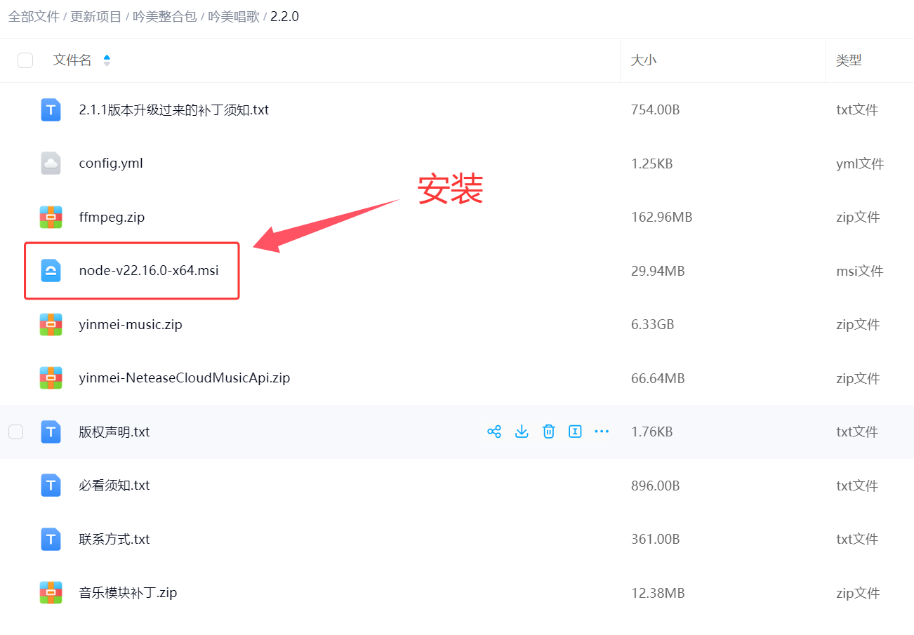
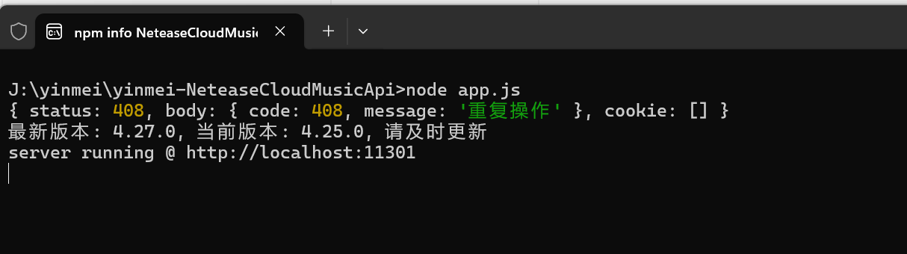
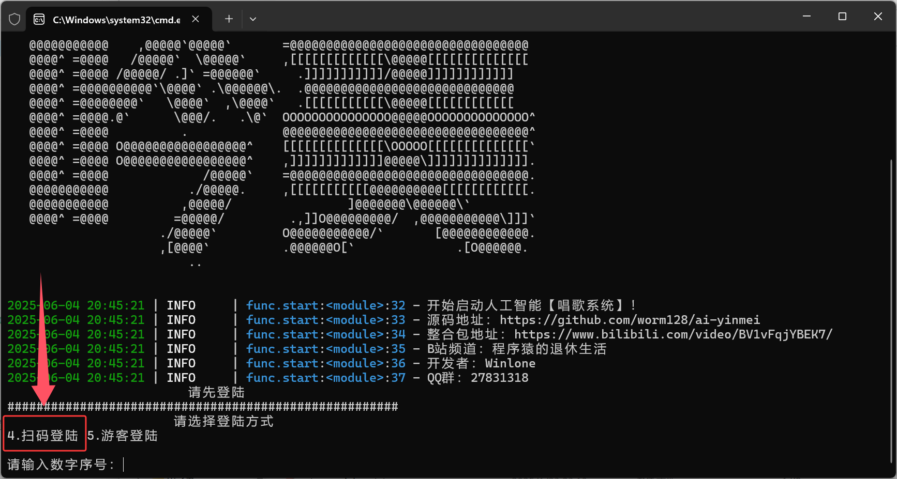
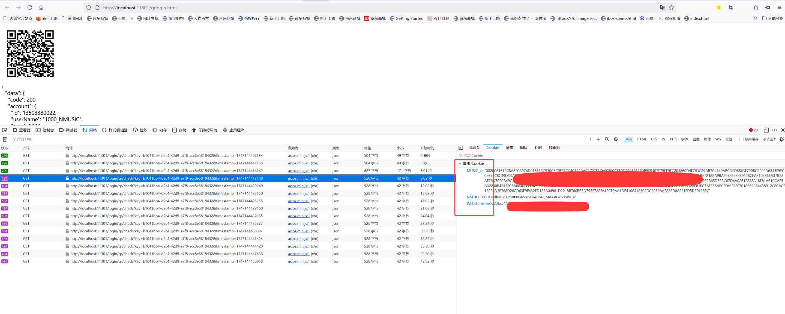
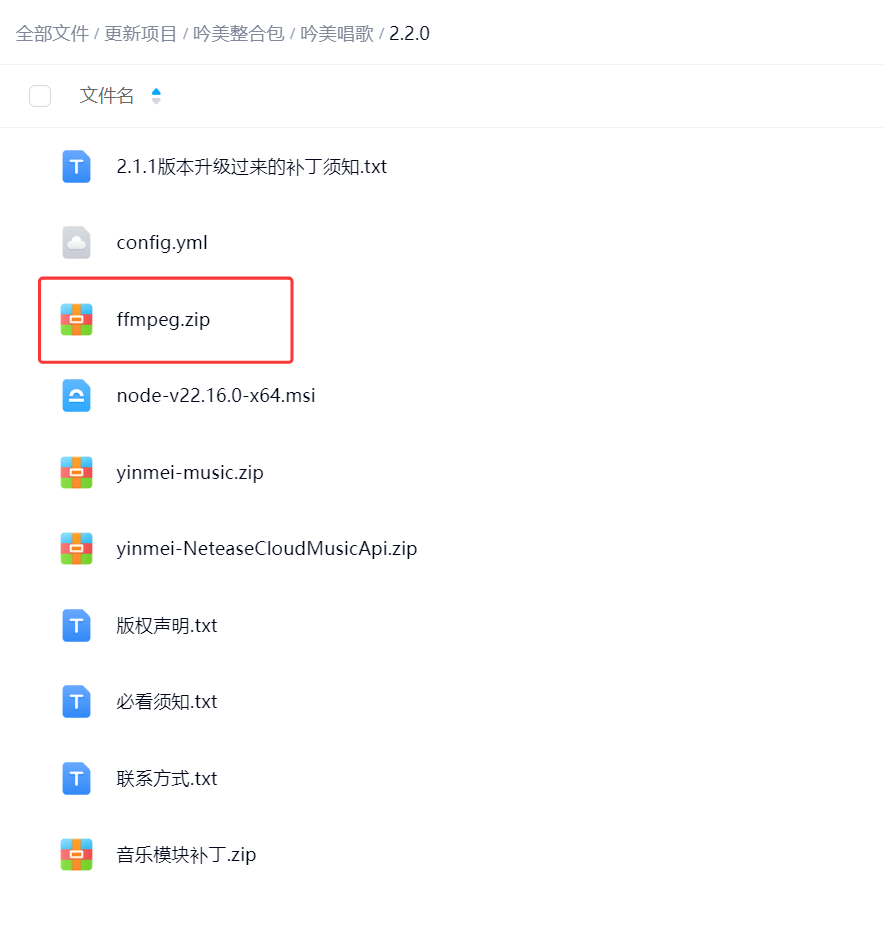
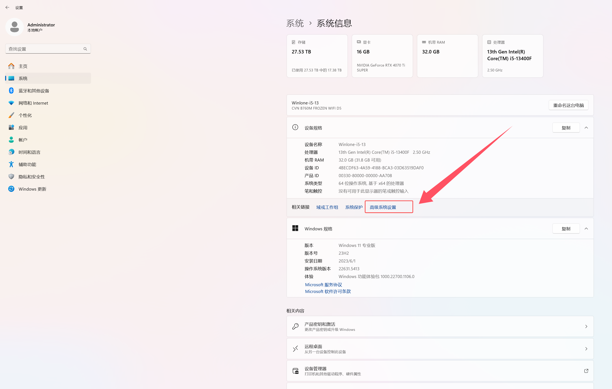
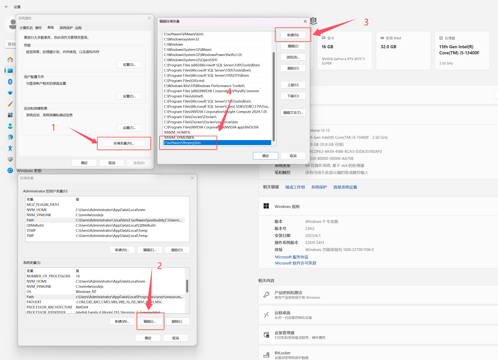
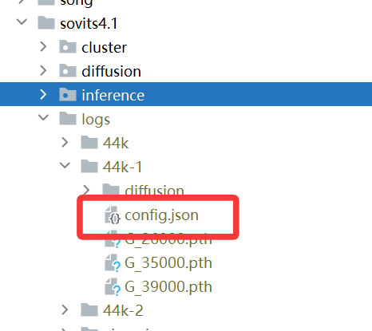
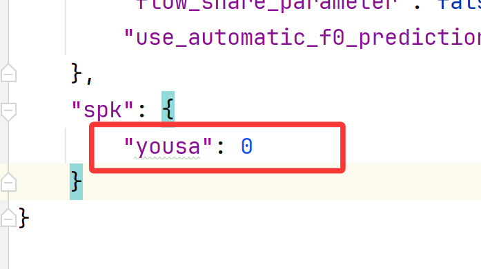
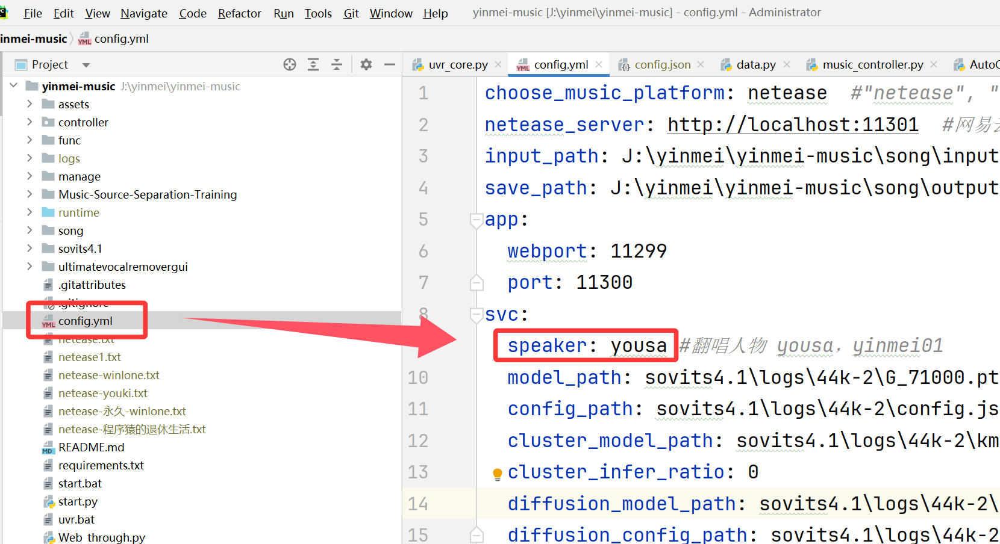

## 一、起動方法
### 1 パッケージのダウンロード
ダウンロードパス：[一度限りの購入](https://mall.bilibili.com/neul-next/detailuniversal/detail.html?isMerchant=1&page=detailuniversal_detail&saleType=10&itemsId=13024783&loadingShow=1&noTitleBar=1&msource=merchant_share)が必要な歌唱モジュールです。使用方法は程序猿的退休生活【QQ：314769095】にお問い合わせください  

### 2、cudaのインストール
**現在のバージョン：**
```cmd
NVIDIA：cuda 12.4
現在のプロジェクト：pytorch 2.4.0+cu124
```
**互換性について：**現在のインストール版はcuda12.4のみ対応しています。50系GPUでより新しいバージョンのcudaが必要な場合は、ご自身でpytorchをアンインストールしてインストールしてください  
cuda開発キットのダウンロード【バージョン12.4】：https://developer.nvidia.com/cuda-12-4-1-download-archive  
cudaの過去バージョン：https://developer.nvidia.com/cuda-toolkit-archive  
**pytorchの再インストール：**  
インストールするpytorchをcu128、cu124、cu126からご自身で選択してください。詳細は[こちら](https://pytorch.org/get-started/locally/)を参照  
プロジェクトのルートディレクトリでcmdを開き、以下のコマンドを実行します：  
```cmd
アンインストール
.\runtime\python.exe -m pip uninstall torch torchvision torchaudio

対応するcuda12.8をインストール
.\runtime\python.exe -m pip install torch torchvision torchaudio --index-url https://download.pytorch.org/whl/cu128
```

ドライババージョン【nvidiaドライバー】：nvidia-smi -l 1  
CUDAプログラム【cudatoolkit開発キット】：nvcc -V  

### 3、yinmei-NeteaseCloudMusicApi
用途：NetEase Musicチャンネル  
nodejsのインストールが必要：  
  
「start.bat」をダブルクリックして起動  
  

### 4、yinmei-music
用途：吟美歌唱  
「yinmei-music-api.exe」または「start.bat」をダブルクリックして起動  
NetEase Musicにログインしていない場合はログインを促されます。4を入力してQRコードでログインします  
  


## 二、ログイン設定
歌唱のQRコード読み取り後、qr/check APIのコールバックでcookieが取得できない場合があります。ブラウザを確認し、MUSIC_UとNMTIDの2つの値をコピーして、yinmei-musicプロジェクトのルートディレクトリにあるnetease.txtファイルに貼り付けてください  
netease.txtの内容形式：NMTIDパラメータが不足していると、マシンキーの交換が使用できません  
```json
{"MUSIC_U": "xxx", "NMTID": "xxxxx"}
```
QRコードログインアドレス：http://localhost:11301/login/qrlogin.html  
  
QRコードログインに成功すると、yinmei-musicプロジェクトのルートディレクトリにnetease.txtファイルが生成されます  

## 三、曲ディレクトリ
input_path: H:\yinmei-music\input  #元の曲のダウンロードパス  
save_path: H:\yinmei-music\output  #歌唱カバーの出力パス  

## 四、FFmpegデコーダーの設定
注意：FFmpegデコーダーがないと、mp3音声ファイルを認識できません  
ダウンロード方法：
[公式サイトからダウンロード](https://ffmpeg.org/download.html#build-windows)  
歌唱網盤からダウンロード：  
  
FFmpegを環境変数に追加：
  
  
FFmpegが有効か確認：  
```cmd
ffmpeg -version
```

## 五、歌唱モデルの切り替え
トレーニングしたモデルの中に、対応するキャラクター名が必要です  
  
  
その後、プロジェクトのルートディレクトリで歌唱キャラクター名を設定すると有効になります  
 
